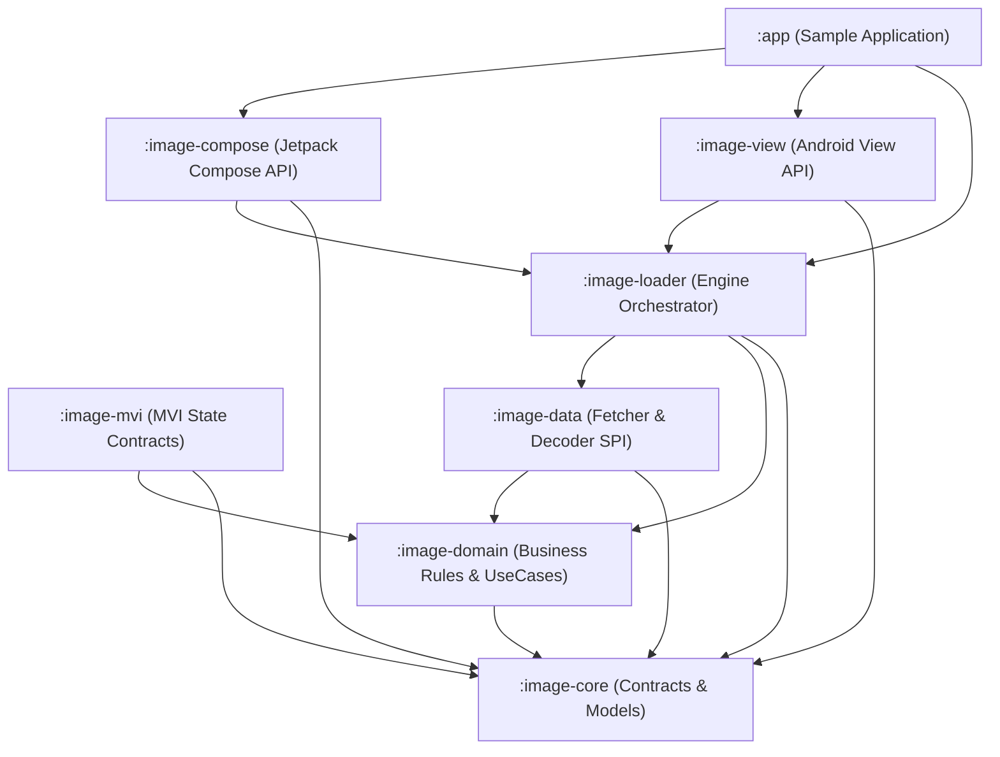
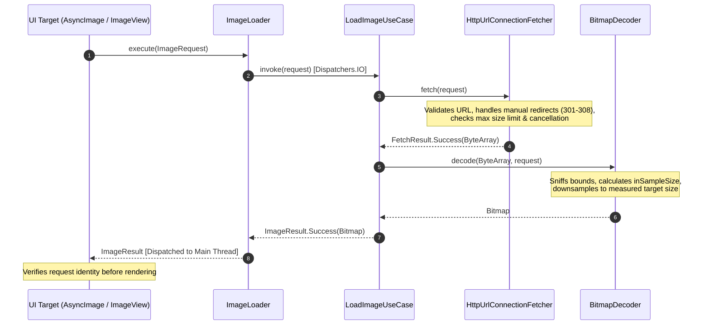

# KotlinImageLoader

KotlinImageLoader is a high-performance, modular image loading library for Android developed in Kotlin. Built upon Clean Architecture and unidirectional data flow principles, it provides first-class integrations for both Jetpack Compose and traditional Android Views.

---

## Architecture Overview

KotlinImageLoader is decoupled across modular boundaries, ensuring separation of concerns, testability, and strict inward dependency flow.

### Modular Dependency Architecture



### Request Execution Lifecycle



---

## Module Breakdown

| Module | Purpose |
|---|---|
| `:image-core` | Public contracts (`ImageLoader`, `Disposable`), models (`ImageRequest`, `ImageSize`, `CachePolicy`, `DataSource`, `ImageResult`). |
| `:image-domain` | Business policies (`ImageRequestValidator`) and use case execution (`LoadImageUseCase`). |
| `:image-data` | Network engine (`HttpUrlConnectionFetcher`) and downsampling decoder (`BitmapDecoder`). |
| `:image-loader` | Composition root implementing `RealImageLoader` and `SingletonImageLoader`. |
| `:image-compose` | Jetpack Compose `AsyncImage` composable with lifecycle-bound cancellation. |
| `:image-view` | View extensions (`ImageView.loadImage`) with PreDraw size resolution and recycling protection. |
| `:image-mvi` | Unidirectional MVI state management (`ImageIntent`, `ImageAction`, `ImageState`, `ImageReducer`, `ImageStore`). |
| `:app` | Demo application showcasing Compose and traditional View implementations. |

---

## Installation via JitPack

Add the JitPack repository to your root `settings.gradle.kts`:

```kotlin
dependencyResolutionManagement {
    repositoriesMode.set(RepositoriesMode.FAIL_ON_PROJECT_REPOS)
    repositories {
        google()
        mavenCentral()
        maven { url = uri("https://jitpack.io") }
    }
}
```

Add the required module dependencies to your application's `build.gradle.kts`:

```kotlin
dependencies {
    // For Jetpack Compose support (includes AsyncImage & ZoomableAsyncImage)
    implementation("com.github.gargpadmakar.KotlinImageLoader:image-compose:1.0.4")

    // For traditional Android View support (includes ImageView.loadImage & ZoomableImageView)
    implementation("com.github.gargpadmakar.KotlinImageLoader:image-view:1.0.4")

    // Core library engine
    implementation("com.github.gargpadmakar.KotlinImageLoader:image-loader:1.0.4")
}
```

---

## Usage

### 1. HTTP Headers & Authentication

You can pass custom HTTP request headers (such as `Authorization` bearer tokens, custom user-agents, API keys) directly using the `ImageRequest.Builder`:

```kotlin
import com.padmakar.imageloader.core.model.ImageRequest

val request = ImageRequest.Builder("https://api.example.com/user/avatar.png")
    .addHeader("Authorization", "Bearer YOUR_ACCESS_TOKEN")
    .addHeader("User-Agent", "KotlinImageLoader/1.0")
    .addHeader("X-Custom-Client", "AndroidApp")
    .build()

// In Compose:
AsyncImage(model = request, contentDescription = "Profile Picture")

// In Android View:
imageView.loadImage(request)
```

---

### 2. Zoomable Image Components (Pinch-to-Zoom & Panning)

KotlinImageLoader provides built-in pinch-to-zoom and double-tap zoom components for both Jetpack Compose and traditional Views without requiring third-party libraries.

#### Jetpack Compose: `ZoomableAsyncImage`
Supports pinch-to-zoom, two-finger panning, and double-tap to zoom/reset:

```kotlin
import com.padmakar.imageloader.compose.ZoomableAsyncImage

@Composable
fun FullscreenPhoto(imageUrl: String) {
    ZoomableAsyncImage(
        model = imageUrl,
        contentDescription = "Zoomable Photo",
        modifier = Modifier.fillMaxSize(),
        minScale = 1.0f,
        maxScale = 5.0f
    )
}
```

#### Android View: `ZoomableImageView`
Use in XML layouts or programmatically:

```xml
<com.padmakar.imageloader.view.ZoomableImageView
    android:id="@+id/zoomableImageView"
    android:layout_width="match_parent"
    android:layout_height="match_parent" />
```

```kotlin
val zoomableImageView = findViewById<ZoomableImageView>(R.id.zoomableImageView)
zoomableImageView.loadImage("https://example.com/highres.jpg")
```

---

### 3. Progressive Streaming Decoding & Offline Fallback

* **Progressive Preview**: Large images decode incrementally in real time during streaming download (low-res preview immediately rendered without waiting for full download).
* **Offline Thumbnail Fallback**: If an image was partially downloaded and network connectivity drops, the cached preview/thumbnail remains visible rather than falling back to a blank error screen.

---

### 4. Jetpack Compose Integration

Use `AsyncImage` directly in your composable hierarchy:

```kotlin
import androidx.compose.foundation.layout.size
import androidx.compose.runtime.Composable
import androidx.compose.ui.Modifier
import androidx.compose.ui.layout.ContentScale
import androidx.compose.ui.res.painterResource
import androidx.compose.ui.unit.dp
import com.padmakar.imageloader.compose.AsyncImage

@Composable
fun UserAvatar(imageUrl: String) {
    AsyncImage(
        model = imageUrl,
        contentDescription = "User Avatar",
        modifier = Modifier.size(100.dp),
        placeholder = painterResource(R.drawable.ic_placeholder),
        error = painterResource(R.drawable.ic_error),
        contentScale = ContentScale.Crop
    )
}
```

#### Lifecycle & Cancellation Guarantees:
* Automatically cancels active image loading tasks when the composable leaves composition.
* Re-keying `model` or constraints immediately resets the internal state, preventing old or stale bitmaps from flashing into view.

---

### 2. Traditional Android View Integration

Load images directly into an `ImageView`:

```kotlin
import android.widget.ImageView
import com.padmakar.imageloader.view.loadImage

// Basic load
imageView.loadImage("https://example.com/photo.jpg")

// Fluent configuration with placeholder and error resources
imageView.loadImage("https://example.com/photo.jpg") {
    placeholder(R.drawable.ic_placeholder)
    error(R.drawable.ic_error)
}
```

#### View Recycling & Stale Image Prevention:
* When used inside a `RecyclerView`, invoking `loadImage` on a recycled `ImageView` immediately disposes any previous ongoing background request.
* Tag-based request identity verification guarantees that only the result corresponding to the most recent request is rendered on the target `ImageView`.
* Cancels active jobs when views detach from windows and handles re-attachment safely.

---

### 3. Target Sizing & Memory Downsampling

By default, `AsyncImage` and `ImageView.loadImage` measure their target UI constraints and automatically downsample bitmaps during decoding:

```kotlin
import com.padmakar.imageloader.core.model.ImageRequest
import com.padmakar.imageloader.core.model.ImageSize

// Explicit exact dimensions
val request = ImageRequest.Builder("https://example.com/large.jpg")
    .size(width = 300, height = 300)
    .build()

// Explicit original dimensions (bounded by maximum safety ceiling of 4096px)
val originalRequest = ImageRequest.Builder("https://example.com/large.jpg")
    .size(ImageSize.Original)
    .build()
```

---

### 4. Custom ImageLoader Configuration

You can instantiate and inject custom `ImageLoader` instances for testing or specialized threading configurations:

```kotlin
import com.padmakar.imageloader.loader.RealImageLoader
import kotlinx.coroutines.Dispatchers

val customImageLoader = RealImageLoader.Builder(context)
    .ioDispatcher(Dispatchers.IO)
    .mainDispatcher(Dispatchers.Main.immediate)
    .build()

// Pass to Compose AsyncImage
AsyncImage(
    model = "https://example.com/photo.jpg",
    contentDescription = null,
    imageLoader = customImageLoader
)

// Pass to ImageView
imageView.loadImage("https://example.com/photo.jpg", imageLoader = customImageLoader)
```

---

## In-Memory Caching (Glide-Style)

KotlinImageLoader integrates a dynamic in-memory LRU cache (`LruMemoryCache`):
* **Cross-Screen / Intent Persistence**: Once an image is loaded, navigating across screens or starting new Intent activities will immediately serve the image from memory cache (`DataSource.MEMORY`) with zero network latency.
* **Heap-Aware Sizing**: Dynamically sizes itself to 25% of the application's available JVM heap, safely evicting least-recently-used bitmaps when memory pressure increases.
* **Configurable Cache Policies**: Controlled via `CachePolicy` (`ENABLED`, `READ_ONLY`, `WRITE_ONLY`, `DISABLED`).

```kotlin
// Example bypassing memory cache
val request = ImageRequest.Builder("https://example.com/live_feed.jpg")
    .memoryCachePolicy(CachePolicy.DISABLED)
    .build()
```

---

## Technical Guarantees

* **Threading Model**: Network streaming and bitmap decoding strictly execute on background worker threads (`Dispatchers.IO`). UI mutations and callback deliveries are pinned to the main thread (`Dispatchers.Main`).
* **Active Interruption**: Coroutine cancellation actively interrupts underlying socket connections via `HttpURLConnection.disconnect()`, immediately terminating stalled or abandoned downloads.
* **HTTP Redirect Engine**: Disables automatic HTTP redirects to manually process 301, 302, 303, 307, and 308 response codes, enforcing a limit of 5 hops and rejecting insecure HTTPS-to-HTTP protocol downgrades.
* **Re-readable Decodes**: Streams are fully buffered into in-memory byte arrays prior to decoding, preventing single-read stream exhaustion during multi-pass bitmap bounds sniffing and downsampling.
* **Resource Safety**: Enforces a strict 50 MB download ceiling and a 4096 px maximum decode boundary to prevent out-of-memory errors on large images.

---

## Permissions

The library requests the Internet permission via manifest merging:

```xml
<uses-permission android:name="android.permission.INTERNET" />
```

---

## License

```
Copyright 2026 Padmakar Garg

Licensed under the Apache License, Version 2.0 (the "License");
you may not use this file except in compliance with the License.
You may obtain a copy of the License at

    http://www.apache.org/licenses/LICENSE-2.0

Unless required by applicable law or agreed to in writing, software
distributed under the License is distributed on an "AS IS" BASIS,
WITHOUT WARRANTIES OR CONDITIONS OF ANY KIND, either express or implied.
See the License for the specific language governing permissions and
limitations under the License.
```
