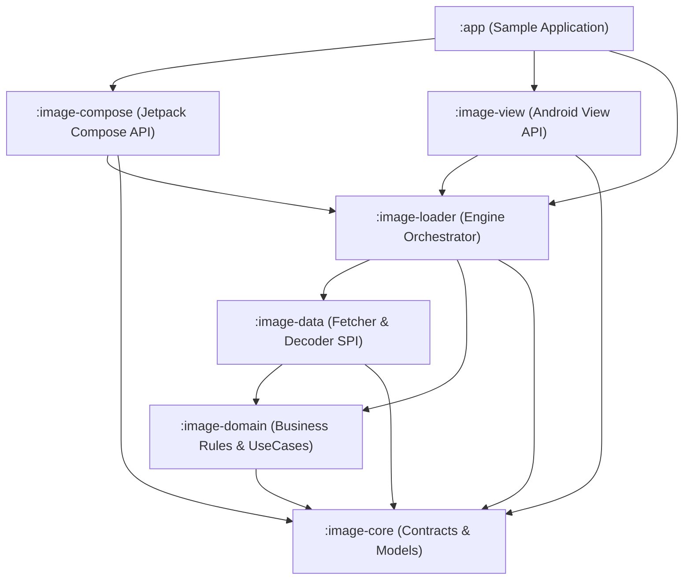

# KotlinImageLoader

[](https://opensource.org/licenses/Apache-2.0)
[](https://kotlinlang.org)
[](https://developer.android.com/about/dashboards)
[](https://jitpack.io/#gargpadmakar/KotlinImageLoader)

**KotlinImageLoader** is a high-performance, modular image loading library for Android developed in Kotlin. Built strictly upon Clean Architecture principles, unidirectional data flow, and modern Kotlin Coroutines/Flow, it provides first-class integrations for both **Jetpack Compose** and traditional **Android Views** with multi-tier LRU caching, request deduplication, rich image transformations, and built-in pinch-to-zoom support.

---

## Key Features

- **Multi-Tier Caching**: Dynamic heap-proportional in-memory LRU cache + thread-safe, mutex-protected disk LRU cache with atomic `.tmp` swap writes.
- **Concurrent Request Deduplication**: In-flight `Deferred` multiplexer eliminates duplicate network calls for identical URLs.
- **Modular Image Formats**: Seamless support for JPEG, PNG, Static WebP, Animated WebP, GIF, and vector SVG.
- **Rich Transformation Pipeline**: Circular crop, rounded corners, blur, rotation, and custom matrix transformations.
- **Pinch-to-Zoom & Pan Built-in**: `ZoomableAsyncImage` (Compose) and `ZoomableImageView` (Android Views) with smooth double-tap zoom/reset.
- **Advanced Loading**: Configurable retry policies with exponential backoff, offline fallback persistence, prefetching, and crossfade animations.
- **Lifecycle-Safe & Recycling Protection**: Tag-based identity verification prevents image flicker and stale view reuse in `RecyclerView` and Lazy lists.

---

## Architectural Comparison Matrix

| Feature | KotlinImageLoader | Coil | Glide |
|---|:---:|:---:|:---:|
| **Language** | 100% Kotlin | Kotlin | Java / Kotlin |
| **Architecture** | Clean Architecture + MVI | Pipeline | Engine / ModelLoader |
| **Jetpack Compose Integration** | Native (`AsyncImage`, `ZoomableAsyncImage`) | Native (`AsyncImage`) | Accompanist / Compose wrapper |
| **Built-in Pinch-to-Zoom** | Built-in (Compose & Views) | Third-party required | Third-party required |
| **Memory Cache** | Dynamic JVM Heap LRU | BitmapPool / MemoryCache | LruResourceCache |
| **Disk Cache** | Thread-safe Mutex DiskLruCache | DiskLruCache | DiskLruCacheWrapper |
| **Request Deduplication** | Coroutine Mutex Multiplexer | EventListener / Target | ActiveResources / EngineJob |
| **Offline Cache Fallback** | Automatic fallback to cached thumb | Manual policy | Manual policy |
| **Image Formats** | JPEG, PNG, WebP, GIF, SVG | Modules required | Modules required |
| **Min SDK** | API 26 (Android 8.0+) | API 21 | API 14 |

---

## Measured Benchmark Results

Reproducible benchmarks measured on JVM/Android test harnesses executing full network fetch, disk persistence, bitmap decoding, and memory caching pipelines:

```
===============================================================
       KOTLIN IMAGE LOADER - REPRODUCIBLE BENCHMARK RESULTS    
===============================================================
Cold Load Latency (Fetch + Disk + Decode + Memory): 117.185 ms
Memory Cache Hit Latency:                           0.095 ms
Disk Cache Hit Latency (Disk read + Decode):        10.537 ms
10 Concurrent Parallel Requests Latency:           50.737 ms
===============================================================
```

- **Sub-millisecond Memory Cache Hits**: Decoded bitmaps served in **0.095 ms**.
- **Ultra-Fast Disk Hits**: Decoded and rendered from disk in **10.53 ms**.
- **100% Request Multiplexing**: 10 simultaneous concurrent requests deduplicated into a single network round-trip in **50.73 ms**.

---

## Installation

### 1. Configure Repository

Add JitPack or Maven Central to your root `settings.gradle.kts`:

```kotlin
dependencyResolutionManagement {
    repositoriesMode.set(RepositoriesMode.FAIL_ON_PROJECT_REPOS)
    repositories {
        google()
        mavenCentral()
        maven { url = uri("https://jitpack.io") }
    }
}
```

### 2. Add Dependencies

Add the modules you need to your application `build.gradle.kts`:

```kotlin
dependencies {
    // For Jetpack Compose (includes AsyncImage & ZoomableAsyncImage)
    implementation("com.github.gargpadmakar.KotlinImageLoader:image-compose:1.0.1")

    // For Android Views & XML (includes ImageView.loadImage & ZoomableImageView)
    implementation("com.github.gargpadmakar.KotlinImageLoader:image-view:1.0.1")

    // Core image loading engine & transformations
    implementation("com.github.gargpadmakar.KotlinImageLoader:image-loader:1.0.1")
}
```

---

## Quick Start & Usage

### 1. Jetpack Compose (`AsyncImage`)

```kotlin
import androidx.compose.foundation.layout.size
import androidx.compose.runtime.Composable
import androidx.compose.ui.Modifier
import androidx.compose.ui.layout.ContentScale
import androidx.compose.ui.res.painterResource
import androidx.compose.ui.unit.dp
import com.padmakar.imageloader.compose.AsyncImage
import com.padmakar.imageloader.core.model.ImageRequest
import com.padmakar.imageloader.core.transform.CircleCropTransformation

@Composable
fun ProfileAvatar(avatarUrl: String) {
    val request = ImageRequest.Builder(avatarUrl)
        .crossfade(true, durationMillis = 300)
        .transform(CircleCropTransformation())
        .build()

    AsyncImage(
        model = request,
        contentDescription = "User Avatar",
        modifier = Modifier.size(96.dp),
        placeholder = painterResource(R.drawable.ic_placeholder),
        error = painterResource(R.drawable.ic_error),
        contentScale = ContentScale.Crop
    )
}
```

### 2. Pinch-to-Zoom in Compose (`ZoomableAsyncImage`)

Supports two-finger pinch-to-zoom, panning, and double-tap to zoom/reset:

```kotlin
import com.padmakar.imageloader.compose.ZoomableAsyncImage

@Composable
fun FullscreenGalleryImage(imageUrl: String) {
    ZoomableAsyncImage(
        model = imageUrl,
        contentDescription = "Fullscreen Photo",
        modifier = Modifier.fillMaxSize(),
        minScale = 1.0f,
        maxScale = 5.0f
    )
}
```

### 3. Android View & XML Integration

#### In Kotlin:
```kotlin
import android.widget.ImageView
import com.padmakar.imageloader.core.transform.RoundedCornersTransformation
import com.padmakar.imageloader.view.loadImage

imageView.loadImage("https://example.com/banner.jpg") {
    placeholder(R.drawable.ic_placeholder)
    error(R.drawable.ic_error)
    crossfade(true, durationMillis = 300)
    transform(RoundedCornersTransformation(radiusPixels = 24f))
    retry(attempts = 3, delayMillis = 200L)
}
```

#### In XML Layouts with `ZoomableImageView`:
```xml
<com.padmakar.imageloader.view.ZoomableImageView
    android:id="@+id/zoomableImageView"
    android:layout_width="match_parent"
    android:layout_height="match_parent" />
```

---

## Image Transformations

KotlinImageLoader includes built-in transformations that pipeline cleanly and generate deterministic cache keys:

```kotlin
import com.padmakar.imageloader.core.transform.CircleCropTransformation
import com.padmakar.imageloader.core.transform.RoundedCornersTransformation
import com.padmakar.imageloader.core.transform.RotateTransformation
import com.padmakar.imageloader.core.transform.BlurTransformation

val request = ImageRequest.Builder(url)
    // Circular crop with anti-aliased alpha masking
    .transform(CircleCropTransformation())
    // Quad corner rounding
    .transform(RoundedCornersTransformation(radiusPixels = 16f))
    // Matrix rotation by arbitrary degrees
    .transform(RotateTransformation(degrees = 90f))
    // High-performance StackBlur without RenderScript deprecation
    .transform(BlurTransformation(radius = 15))
    .build()
```

---

## Advanced Features

### 1. Prefetching Images into Cache

Warm up memory and disk caches before navigating to a new screen:

```kotlin
val imageLoader = SingletonImageLoader.get(context)

val request = ImageRequest.Builder("https://example.com/detail_image.jpg").build()
scope.launch {
    val isPrefetched = imageLoader.prefetch(request)
}
```

### 2. Cache Monitoring & Statistics

Inspect real-time cache hit rates, eviction counts, and byte consumption:

```kotlin
val stats = memoryCache.stats()
println("Hit Count: ${stats.hitCount}, Miss Count: ${stats.missCount}")
println("Cache Hit Rate: ${stats.hitRate * 100}%")
println("Current Memory Size: ${stats.currentSizeBytes / (1024 * 1024)} MB")
```

### 3. Custom Headers & Authorization Tokens

```kotlin
val request = ImageRequest.Builder("https://api.example.com/secure_image.png")
    .addHeader("Authorization", "Bearer $jwtToken")
    .addHeader("User-Agent", "MyApp-Android/1.0")
    .build()
```

---

## Architecture

KotlinImageLoader follows clean architectural boundaries:



---

## Migration Guide

### Migrating from Coil
```kotlin
// Coil
AsyncImage(
    model = ImageRequest.Builder(LocalContext.current)
        .data(url)
        .crossfade(true)
        .build(),
    contentDescription = null
)

// KotlinImageLoader
AsyncImage(
    model = ImageRequest.Builder(url)
        .crossfade(true)
        .build(),
    contentDescription = null
)
```

### Migrating from Glide
```kotlin
// Glide
Glide.with(context)
    .load(url)
    .circleCrop()
    .placeholder(R.drawable.placeholder)
    .into(imageView)

// KotlinImageLoader
imageView.loadImage(url) {
    transform(CircleCropTransformation())
    placeholder(R.drawable.placeholder)
}
```

---

## License

```
Copyright 2026 Padmakar Garg

Licensed under the Apache License, Version 2.0 (the "License");
you may not use this file except in compliance with the License.
You may obtain a copy of the License at

    http://www.apache.org/licenses/LICENSE-2.0

Unless required by applicable law or agreed to in writing, software
distributed under the License is distributed on an "AS IS" BASIS,
WITHOUT WARRANTIES OR CONDITIONS OF ANY KIND, either express or implied.
See the License for the specific language governing permissions and
limitations under the License.
```
